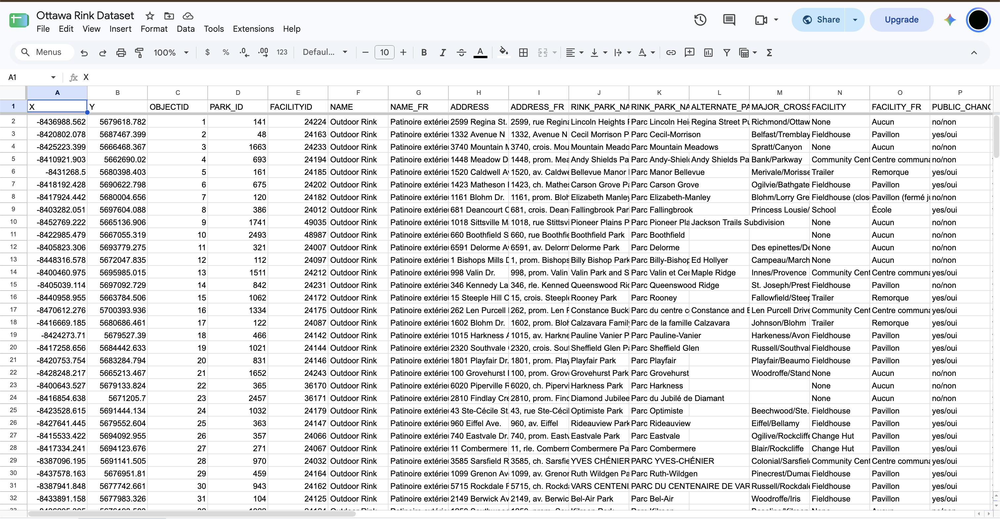
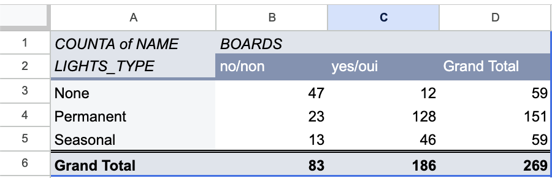
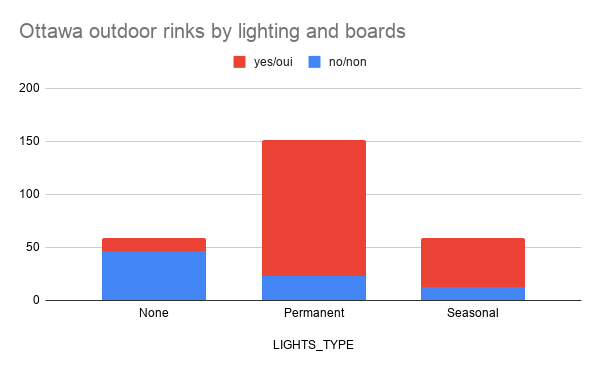

**November 3th, 2026** 
**MPAD 2003 Introductory Data Storytelling** 
**Cole Champion** 
**Presented to Jean-Sébastien Marier** 

# Deliverable 2: Exploratory Data Analysis (EDA)

## Foreword
Deliverable 1 questioned the possibility that money is what explains who lives near Ottawa’s free ice. Taking a closer look, I noticed it mostly doesn't. The ward with the highest median income surprisingly had the worst access in the city, the opposite of the story I was trying to tell. However, this story will only hold up if its data does as well. So I went back and looked at Ottawa's outdoor rink inventory, aware that before I draw any more from that file I need to know what it actually supports. 

## 1. Getting Data

 

The dataset I used is the City Of Ottawa’s Outdoor rink layer, downloaded as a CSV from Open Ottawa, which fronts the Parks Inventory map service (https://maps.ottawa.ca/arcgis/rest/services/Parks_Inventory/MapServer/13)
In the Deliverable 1, I pulled from that service directly due to the CSV being locked behind a sign-in that I lacked at the time. I proceeded to import the file into a blank Google Sheet via File -> Import -> Upload, comma-separated, “Replace spreadsheet,” and then froze the header row.

### Public Sheet Link
[Ottawa Rink Dataset](https://docs.google.com/spreadsheets/d/1DNuw5EDWt_dg02KeKDsTmrjvEAQHALMLfkTT4MckVsk/edit?usp=sharing)

In Deliverable 1, I reported 288 records across 41 fields. The pull I took November 3, 2026, has 269 rows and 42 columns. This leads me to think that the other 19 rinks have been edited or removed since. This considered, results may also be different due to just downloading the CSV instead of actually reading through the map service. From here on, every number from here uses this copy. On first glance, the data looks clean, though `LINK_DESCRIPTION` is empty and 88% of rinks are missing `CREATED_DATE`. 

`BOARDS` and `ACCESSIBLE` are nominal variables, meaning labels with no order to them. Each variable has `yes/oui` or `no/non` as the two possible answers. `LIGHTS_TYPE`, also nominal, has three possible answers consisting of Permanent, Seasonal, or nothing at all. I'll be able to sort through and compare `MODIFIED_DATE` as it's a real date variable. `CREATED_DATE` would be the same but it's typed inconsistently, meaning the spreadsheet reads it as plain text.  

`MODIFIED_DATE` raises my main question. It's important to know that of the 269 rinks it holds, 145 have not been touched since 2019, and no records in the file have been updated since November 2024. Considering the seven year age of over half these entries, it makes me wonder if I may be describing these rinks as they were before the Covid-19 Pandemic, and not how they will be this upcoming winter season.

Previously mentioned as well, I expected income to predict one's access to rinks. I found in my first deliverable that it barely does, r = -0.15.

## 2. Understanding Data

### 2.1. VIMO Analysis

I focused on three columns that my story is built from: BOARDS, `ACCESSIBLE`, and `LIGHTS_TYPE`. Contributing as well are the two date columns that tell me if the file is current.

Valid. `BOARDS` and `ACCESSIBLE` are the most consistent, cleanest columns in the file. In all 269 rows, these variables carry `yes/oui` or `no/non`, with no errors, including blank boxes and stray capitals. `LIGHTS_TYPE` is also valid but only where it's filled in, and uses `Permanent` or `Seasonal`. `MODIFIED_DATE` is clean as well, with all 264 of its filled cells written as `2019/01/14 13:35:35+00`

Invalid. `CREATED_DATE` is the column causing the problems. The 31 rinks that have this variable are split into more than one format: `2017-Nov-10 3:06:15 PM` for some, `12/12/2013 11:25:57 AM` for the other ones. Google Sheets can’t read the column as dates and considers all the variables as text due to the styles disagreeing; this stops me from being able to sort through it. Looking through, I found 3 cells that contained `<Null>` text instead of actual empty cells, in `SUPERVISION` and the two `SUPERVISED_HOURS` columns. The reader of the sheet sees a blank, but the formula counts it as a word. 

Missing. As previously mentioned, `CREATED_DATE` is absent from 238 of the 269 rinks in the dataset, or 88%. `LIGHTS_TYPE` is missing from 59 rinks, `ICE_MAINTENANCE` is blank for 26, `FACILITYID` for 11 and `MODIFIED_DATE` for 5. When it comes to `LIGHTS_TYPE`, I feel these matter the most due to the fact that we won’t know if these rinks have no lights or were simply never recorded. The blanks in the `ICE_MAINTENANCE` aren't a substantial gap but a costly one, since CTV News reported last January that some rinks were at risk of not opening at all due to volunteer shortages (Charbonneau, 2026). It's difficult to tell who's responsible for the ice. 

Outliers. In a statistical sense, nominal columns like the ones in my dataset can’t technically have outliers; however, two stand out as unusual to me. Out of 269 rinks, 9 are deemed accessible. `RINK_TYPE` only shows 4 refrigerated ice surfaces, 1 oval, and 1 combined rink-puddle-oval. All are rare enough that comparison by type would be distorted. 

### 2.2. Cleaning Data

 
#### Freezing rows and columns.

 I started by freezing row 1 and column F (`NAME`) through View -> Freeze. 45 columns made scrolling right and left quite frustrating when looking at `yes/oui` values, not seeing the rink they belonged to. 

#### Trim whitespace.

 Data-> Data cleanup -> Trim whitespace; ended up reporting three trimmed cells in `ADDRESS` (row 108), `PARKNAME` (row 52), and `SUPERVISED_HOURS` (row 154). An address showed `469 Donald `, with a noticeable space at the end. If left alone, `Eugène Martineau Park ` would have counted as a completely different park from `Eugène Martineau Park`. 

#### Find and Replace.

 I found 3 `<Null>` cells from my VIMO analysis, and they were all located in row 49. I cleared them using Edit -> Find and Replace with the replace box empty and “Match entire cell contents” ticked. This stopped me from striking any cells that even just contained the word.

#### SPLIT. 

`MODIFIED_DATE` holds a date and timestamp combined as `2019/01/14 13:35:35+00`, I inserted two columns to the left and split the pair into `MOD_DATE` and `MOD_TIME` using the following function: `=SPLIT(AC2, " ")`

Five records have no `MODIFIED_DATE`, so in those places I found `#VALUE!`, I cleared those by hand.

#### CONCATENATE.

 `FACILITYID` shows up blank for 11 rinks, meaning I couldn't use it to tell the records apart. I created an identifier in a new column called `RINK_ID` which joined the park number with the park name. Using the following function: `=CONCATENATE(D2, "-", J2)`
Must clarify as well that `RINK_ID` is mine rather than the City’s and `FACILITYID` remains beside it, untouched.

### 2.3. Analyzing Data

In my pivot table, I weighed `LIGHTS_TYPE` against `BOARDS`, counting rinks with COUNTA on `NAME`. These variables working together decide whether a rink can be playable after the sun sets. 

#### Pivot Table of lights by boards
 
Figure 1.  This Pivot table shows the count of Ottawa outdoor rinks by lighting type and presence of boards.
#### Ottawa outdoor rinks by lighting and boards
 
Figure 2. Exploratory chart showing Ottawa's outdoor rinks by lighting type, split by whether the rink has boards.

Out of 269, 128 rinks have both. This chart shows that the two travel together; 47 of 59 nonlit rinks also don't have boards, meaning that rinks tend to be equipped or not at all. 

`ICE_MAINTENANCE` matters most. 215 of 269 rinks are volunteer-run; access may depend on who floods the ice rather than income. The next step is crossing that column against ward income.  

## 3. Delivering Data

Insert text here.

## 4. References

Include a list of your references here. Please follow [APA](https://apastyle.apa.org/style-grammar-guidelines/references) or [MLA](https://www.mla.org/MLA-Style) guidelines for references. Hanging paragraphs aren't required though.

**Here's an example:**

Bounegru, L., & Gray, J. (Eds.). (2021). *The Data Journalism Handbook 2: Towards A Critical Data Practice*. Amsterdam University Press. [https://ocul-crl.primo.exlibrisgroup.com/permalink/01OCUL_CRL/hgdufh/alma991022890087305153](https://ocul-crl.primo.exlibrisgroup.com/permalink/01OCUL_CRL/hgdufh/alma991022890087305153)
