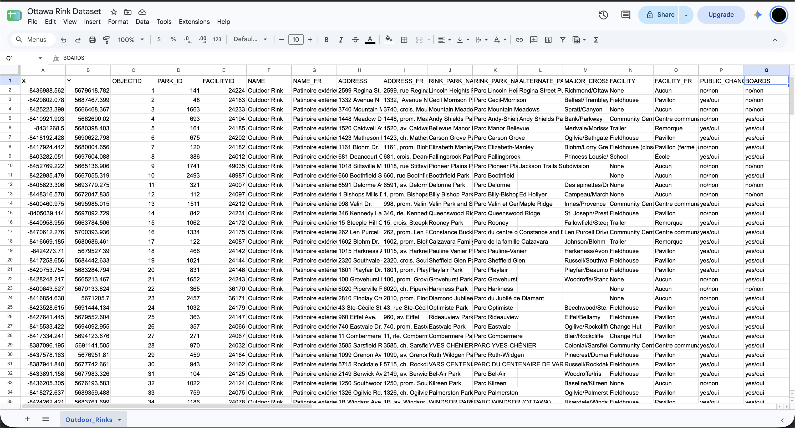

**November 3th, 2026** 
**MPAD 2003 Introductory Data Storytelling** 
**Cole Champion** 
**Presented to Jean-Sébastien Marier** 

# Deliverable 2: Exploratory Data Analysis (EDA)

## Foreword
Deliverable 1 questioned the possibility that money is what explains who lives near Ottawa’s free ice. Taking a closer look, I noticed it mostly doesn't. The ward with the highest median income surprisingly had the worst access in the city, the opposite of the story I was trying to tell. However, this story will only hold up if its data does as well. So I went back and looked at Ottawa's outdoor rink inventory, aware that before I draw any more from that file I need to know what it actually supports. 

## 1. Getting Data

 

The dataset I used is the City Of Ottawa’s Outdoor rink layer, downloaded as a CSV from Open Ottawa, which fronts the Parks Inventory map service (https://maps.ottawa.ca/arcgis/rest/services/Parks_Inventory/MapServer/13)
In the Deliverable 1, I pulled from that service directly due to the CSV being locked behind a sign-in that I lacked at the time. I proceeded to import the file into a blank Google Sheet via File -> Import -> Upload, comma-separated, “Replace spreadsheet,” and then froze the header row.

### Public Sheet Link
[Ottawa Rink Dataset](https://docs.google.com/spreadsheets/d/1DNuw5EDWt_dg02KeKDsTmrjvEAQHALMLfkTT4MckVsk/edit?usp=sharing)

In Deliverable 1, I reported 288 records across 41 fields. The pull I took November 3, 2026, has 269 rows and 42 columns. This leads me to think that the other 19 rinks have been edited or removed since. This considered, results may also be different due to just downloading the CSV instead of actually reading through the map service. From here on, every number from here uses this copy. On first glance, the data looks clean, though LINK_DESCRIPTION is empty and 88% of rinks are missing CREATED_DATE. 

`BOARDS` and `ACCESSIBLE` are nominal variables, meaning labels with no order to them. Each variable has yes/oui or no/non as the two possible answers. `LIGHTS_TYPE`, also nominal, has three possible answers consisting of Permanent, Seasonal, or nothing at all. I'll be able to sort through and compare `MODIFIED_DATE` as it's a real date variable. `CREATED_DATE` would be the same but it's typed inconsistently, meaning the spreadsheet reads it as plain text.  

`MODIFIED_DATE` raises my main question. It's important to know that of the 269 rinks it holds, 145 have not been touched since 2019, and no records in the file have been updated since November 2024. Considering the seven year age of over half these entries, it makes me wonder if I may be describing these rinks as they were before the Covid-19 Pandemic, and not how they will be this upcoming winter season.

Previously mentioned as well, I expected income to predict one's access to rinks. I found in my first deliverable that it barely does, r = 0.15.

## 2. Understanding Data

### 2.1. VIMO Analysis

Use three hashtag symbols (`###`) to create a level 3 heading like this one. Please follow this template when it comes to level 1 and level 2 headings. However, you can use level 3 headings as you see fit.

Insert text here.

Support your claims by citing relevant sources. Please follow [APA guidelines for in-text citations](https://apastyle.apa.org/style-grammar-guidelines/citations).

**For example:**

As seen in Bounegru & Gray (2011), a data visualization should be clear...

### 2.2. Cleaning Data

Insert text here.

### 2.3. Analyzing Data

Insert text here.

**This section should include a screen capture of your pivot table, like so:**

 
*Figure 2: This pivot table shows...*

**This section should also include a screen capture of your exploratory chart, like so:**

 
*Figure 3: This exploratory chart shows...*

## 3. Delivering Data

Insert text here.

## 4. References

Include a list of your references here. Please follow [APA](https://apastyle.apa.org/style-grammar-guidelines/references) or [MLA](https://www.mla.org/MLA-Style) guidelines for references. Hanging paragraphs aren't required though.

**Here's an example:**

Bounegru, L., & Gray, J. (Eds.). (2021). *The Data Journalism Handbook 2: Towards A Critical Data Practice*. Amsterdam University Press. [https://ocul-crl.primo.exlibrisgroup.com/permalink/01OCUL_CRL/hgdufh/alma991022890087305153](https://ocul-crl.primo.exlibrisgroup.com/permalink/01OCUL_CRL/hgdufh/alma991022890087305153)
